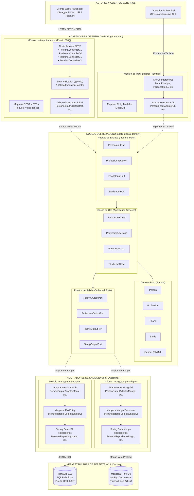
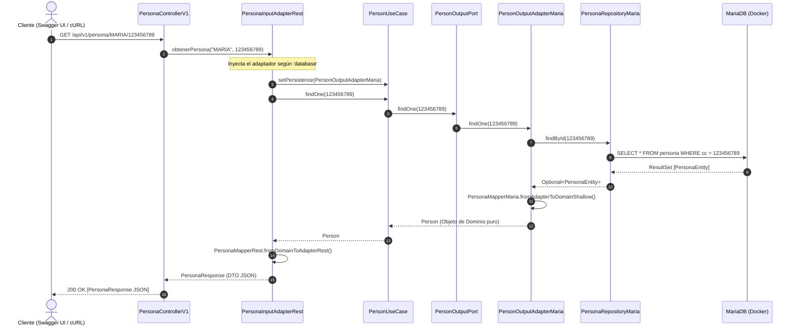

# Laboratorio 2: Implementación de Servicio WEB en Arquitectura Hexagonal con Repository y Service

---

## 1. Portada

* **Título del Proyecto:** Implementación de Servicio WEB en Arquitectura Hexagonal con Repository y Service (PersonAPP)
* **Asignatura:** Arquitectura de Software
* **Institución:** Pontificia Universidad Javeriana
* **Facultad:** Facultad de Ingeniería
* **Carrera:** Ingeniería de Sistemas
* **Integrantes del Equipo:**
  * Nicolás León Parra ([@Nicolas11Leon](https://github.com/Nicolas11Leon))
  * Juan Pablo Espinosa ([@savaged-22](https://github.com/savaged-22))
  * [@Warriorr89](https://github.com/Warriorr89)
* **Docente:** Andrés Sánchez
* **Fecha de Entrega:** Noviembre de 2026
* **Repositorio Oficial:** [https://github.com/Nicolas11Leon/taller-java](https://github.com/Nicolas11Leon/taller-java)
* **TAG de Entrega:** [`v1.0.0`](https://github.com/Nicolas11Leon/taller-java/releases/tag/v1.0.0)

---

## 2. Marco Conceptual

### 2.1 Arquitectura Hexagonal (Puertos y Adaptadores)
Propuesta por Alistair Cockburn en 2005, la **Arquitectura Hexagonal** (conocida también como *Ports and Adapters*) tiene como objetivo principal desacoplar la lógica de negocio central de los mecanismos de entrega (interfaces de usuario, controladores REST, terminales) y de la infraestructura de persistencia (bases de datos, colas de mensajería, servicios externos).

El modelo divide el sistema en tres componentes fundamentales:
1. **El Núcleo (Inside the Hexagon):** Compuesto por el **Dominio** (entidades, objetos de valor y reglas de negocio puras) y la **Capa de Aplicación** (casos de uso que orquestan el comportamiento del sistema). Este núcleo es agnóstico a cualquier tecnología, framework o base de datos.
2. **Puertos (Ports):** Son contratos formales (interfaces Java) que delimitan la frontera del hexágono.
   * **Puertos de Entrada (*Driving / Inbound Ports*):** Exponen los casos de uso hacia los actores que desean interactuar con el sistema (e.g., `PersonInputPort`, `ProfessionInputPort`, `PhoneInputPort`, `StudyInputPort`).
   * **Puertos de Salida (*Driven / Outbound Ports*):** Definen las dependencias que el núcleo necesita que el exterior implemente, como la persistencia (e.g., `PersonOutputPort`, `ProfessionOutputPort`, `PhoneOutputPort`, `StudyOutputPort`).
3. **Adaptadores (Adapters):** Implementaciones tecnológicas concretas que se "enchufan" a los puertos:
   * **Adaptadores de Entrada (*Driving Adapters*):** Traducen estímulos del exterior (solicitudes HTTP REST o comandos de consola CLI) en llamadas a los métodos del puerto de entrada.
   * **Adaptadores de Salida (*Driven Adapters*):** Traducen las peticiones del puerto de salida a consultas y transacciones concretas en MariaDB (JPA/Hibernate) o MongoDB (Spring Data MongoDB).

### 2.2 Principio de Inversión de Dependencias (DIP - SOLID)
La regla de oro de la arquitectura limpia establece que **las dependencias de código fuente solo deben apuntar hacia adentro**, hacia las políticas de alto nivel.
* En lugar de que el caso de uso dependa directamente de una clase concreta como `PersonRepositoryMaria`, el caso de uso depende de la interfaz abstracta `PersonOutputPort`.
* El adaptador de persistencia depende e implementa esa interfaz. De este modo, la persistencia puede reemplazarse o modificarse sin afectar el código de negocio.

### 2.3 Persistencia Políglota Dinámica
El proyecto demuestra desacoplamiento absoluto al soportar simultáneamente dos paradigmas de almacenamiento:
* **Relacional (MariaDB):** Almacenamiento estructurado en tablas con claves primarias (`PK`), claves foráneas (`FK`), claves compuestas e integridad referencial estricta.
* **Documental NoSQL (MongoDB):** Almacenamiento en colecciones de documentos BSON semiestructurados y referencias a documentos mediante `@DocumentReference`.

Mediante inyección de dependencias en tiempo de ejecución, el sistema permite que una misma petición decida si opera sobre `MARIA` o sobre `MONGO` sin requerir cambios en el código de aplicación.

### 2.4 Patrón Repositorio y Servicio (Use Case)
* **Repository Pattern:** Encapsula la lógica necesaria para acceder a las fuentes de datos, centralizando el mapeo de entidades de base de datos a objetos de dominio.
* **Service / Use Case Pattern:** Define la frontera transaccional, ejecuta las reglas del negocio (validaciones de edad, existencia previa para edición o borrado) y coordina las llamadas a los puertos.

---

## 3. Diseño de la Arquitectura del Sistema

### 3.1 Diagrama de Arquitectura Hexagonal Detallado

El siguiente diagrama ilustra formalmente cómo los componentes del sistema se organizan en torno al hexágono central, destacando la separación entre adaptadores de entrada, puertos, casos de uso, dominio y adaptadores de salida:



---

### 3.2 Diagrama Entidad-Relación (Modelo de Datos)

El modelo de datos implementado consta de cuatro entidades interconectadas, modelando personas, sus profesiones, sus líneas telefónicas y sus estudios cursados:

```mermaid
erDiagram
    PERSONA ||--o{ TELEFONO : "posee (1:N)"
    PERSONA ||--o{ ESTUDIOS : "cursa (1:N)"
    PROFESION ||--o{ ESTUDIOS : "pertenece (1:N)"

    PERSONA {
        int cc PK "Cédula de ciudadanía (Identificación)"
        varchar nombre "Nombres de la persona"
        varchar apellido "Apellidos de la persona"
        enum genero "Género ('M', 'F')"
        int edad "Edad en años"
    }

    PROFESION {
        int id PK "Identificador de la profesión"
        varchar nom "Nombre de la profesión"
        text des "Descripción del campo profesional"
    }

    TELEFONO {
        varchar num PK "Número telefónico (15 chars)"
        varchar oper "Operador celular (Claro, Movistar, etc.)"
        int duenio FK "Cédula del propietario (FK -> PERSONA.cc)"
    }

    ESTUDIOS {
        int id_prof PK_FK "ID de la profesión (FK -> PROFESION.id)"
        int cc_per PK_FK "Cédula de la persona (FK -> PERSONA.cc)"
        date fecha "Fecha de graduación"
        varchar univer "Nombre de la institución universitaria"
    }
```

---

### 3.3 Diagrama de Secuencia: Flujo de Ejecución Extremo a Extremo

A continuación se presenta el flujo completo de una operación de lectura (`GET /api/v1/persona/{database}/{cc}`):



---

### 3.4 Estructura Modular del Proyecto (Maven Multi-Módulo)

El proyecto está dividido en siete módulos desacoplados para garantizar la pureza arquitectural:

| Módulo | Tipo de Componente | Rol en la Arquitectura | Dependencias Permitidas |
| :--- | :--- | :--- | :--- |
| **`domain`** | Núcleo | Entidades de dominio puras (`Person`, `Profession`, `Phone`, `Study`, `Gender`). | Ninguna (solo Lombok opcional). |
| **`common`** | Transversal | Anotaciones arquitecturales (`@Port`, `@Adapter`, `@UseCase`, `@Mapper`) y excepciones. | Ninguna. |
| **`application`** | Núcleo | Casos de uso (`*UseCase`) y contratos de puertos (`*InputPort`, `*OutputPort`). | `domain`, `common`. |
| **`maria-output-adapter`** | Adaptador Salida | Entidades JPA, Repositorios Spring Data JPA y adaptadores de salida para MariaDB. | `domain`, `application`, `common`, Spring Data JPA. |
| **`mongo-output-adapter`** | Adaptador Salida | Documentos BSON, Repositorios Mongo y adaptadores de salida para MongoDB. | `domain`, `application`, `common`, Spring Data Mongo. |
| **`rest-input-adapter`** | Adaptador Entrada | Controladores Spring MVC REST, Swagger 3 OpenAPI, DTOs y mappers HTTP. | `application`, `maria-output-adapter`, `mongo-output-adapter`, Spring Web. |
| **`cli-input-adapter`** | Adaptador Entrada | Menús de consola interactivos (`CommandLineRunner`) y mappers de consola. | `application`, `maria-output-adapter`, `mongo-output-adapter`. |

---

## 4. Matriz de los 6 Métodos por Entidad (3 de Lectura y 3 de Escritura)

El sistema implementa rigurosamente **6 métodos por cada entidad** (24 endpoints REST y 24 opciones CLI en total):

| Entidad | Operación | Tipo | Método Caso de Uso | Endpoint REST | Opción Menú CLI |
| :--- | :--- | :---: | :--- | :--- | :--- |
| **Persona** | Listar todo | Lectura 1 | `findAll()` | `GET /api/v1/persona/{database}` | `1: Ver todas` |
| | Buscar por CC | Lectura 2 | `findOne(cc)` | `GET /api/v1/persona/{database}/{cc}` | `2: Buscar por cédula` |
| | Contar total | Lectura 3 | `count()` | `GET /api/v1/persona/{database}/count` | `6: Contar total` |
| | Crear | Escritura 1 | `create(person)` | `POST /api/v1/persona` *(JSON body)* | `3: Crear nueva` |
| | Editar | Escritura 2 | `edit(cc, person)` | `PUT /api/v1/persona/{database}/{cc}` | `4: Editar existente` |
| | Eliminar | Escritura 3 | `drop(cc)` | `DELETE /api/v1/persona/{database}/{cc}`| `5: Eliminar` |
| **Profesión** | Listar todo | Lectura 1 | `findAll()` | `GET /api/v1/profesion/{database}` | `1: Ver todas` |
| | Buscar por ID | Lectura 2 | `findOne(id)` | `GET /api/v1/profesion/{database}/{id}` | `2: Buscar por ID` |
| | Contar total | Lectura 3 | `count()` | `GET /api/v1/profesion/{database}/count` | `6: Contar total` |
| | Crear | Escritura 1 | `create(profession)` | `POST /api/v1/profesion` *(JSON body)* | `3: Crear nueva` |
| | Editar | Escritura 2 | `edit(id, profession)` | `PUT /api/v1/profesion/{database}/{id}` | `4: Editar existente` |
| | Eliminar | Escritura 3 | `drop(id)` | `DELETE /api/v1/profesion/{database}/{id}`| `5: Eliminar` |
| **Teléfono** | Listar todo | Lectura 1 | `findAll()` | `GET /api/v1/telefono/{database}` | `1: Ver todos` |
| | Buscar por Núm | Lectura 2 | `findOne(number)` | `GET /api/v1/telefono/{database}/{num}` | `2: Buscar por número` |
| | Contar total | Lectura 3 | `count()` | `GET /api/v1/telefono/{database}/count` | `6: Contar total` |
| | Crear | Escritura 1 | `create(phone)` | `POST /api/v1/telefono` *(JSON body)* | `3: Crear nuevo` |
| | Editar | Escritura 2 | `edit(num, phone)` | `PUT /api/v1/telefono/{database}/{num}` | `4: Editar existente` |
| | Eliminar | Escritura 3 | `drop(num)` | `DELETE /api/v1/telefono/{database}/{num}`| `5: Eliminar` |
| **Estudios** | Listar todo | Lectura 1 | `findAll()` | `GET /api/v1/estudio/{database}` | `1: Ver todos` |
| | Buscar por Llave | Lectura 2 | `findOne(idProf, cc)` | `GET /api/v1/estudio/{database}/{idProf}/{cc}` | `2: Buscar por clave` |
| | Contar total | Lectura 3 | `count()` | `GET /api/v1/estudio/{database}/count` | `6: Contar total` |
| | Crear | Escritura 1 | `create(study)` | `POST /api/v1/estudio` *(JSON body)* | `3: Crear nuevo` |
| | Editar | Escritura 2 | `edit(idProf, cc, study)` | `PUT /api/v1/estudio/{database}/{idProf}/{cc}` | `4: Editar existente` |
| | Eliminar | Escritura 3 | `drop(idProf, cc)` | `DELETE /api/v1/estudio/{database}/{idProf}/{cc}`| `5: Eliminar` |

---

## 5. Procedimiento de Implementación y Solución de Problemas

Durante el desarrollo a partir de la plantilla base (`personapp-hexa-spring-boot`), se resolvieron varios desafíos arquitecturales y técnicos:

### 5.1 Corrección de Bugs en la Plantilla Base
1. **Mapeadores de Estudios retornando `null`:**
   En `EstudiosMapperMaria` y `EstudiosMapperMongo`, el método `fromAdapterToDomain` finalizaba con `return null;` en lugar de devolver la entidad `Study` construida. Se corrigió para retornar la instancia con sus relaciones resueltas.
2. **Ciclos de Referencia y Recursión Infinita (`StackOverflowError`):**
   Las relaciones bidireccionales entre `Persona`, `Estudios` y `Profesión` provocaban que el mapeo de una persona intentara mapear sus estudios, y cada estudio intentara mapear de nuevo a la persona, colapsando la pila de ejecución. Se implementaron métodos `fromAdapterToDomainShallow` que mapean únicamente los atributos escalares sin invocar colecciones hijas de vuelta.
3. **Incompatibilidad de Fechas SQL en Java 17:**
   La clase `java.sql.Date` lanzaba `UnsupportedOperationException` al invocar `toInstant()` durante la conversión a `LocalDate`. Se reemplazó por la conversión directa `((java.sql.Date) fecha).toLocalDate()`.
4. **Empaquetado de Fat JARs en Maven:**
   Al ser un proyecto multi-módulo que no hereda de `spring-boot-starter-parent`, los plugins de `rest-input-adapter` y `cli-input-adapter` requerían la ejecución explícita del goal `repackage` y la definición de las clases principales `PersonAppRestApi` y `PersonAppCli` para generar JARs ejecutables autónomos.

### 5.2 Implementación de Puertos y Casos de Uso
* Se crearon los puertos de entrada y salida para `Profession`, `Phone` y `Study`.
* Se desarrollaron los casos de uso `ProfessionUseCase`, `PhoneUseCase` y `StudyUseCase` con validaciones de existencia previa para operaciones de edición y eliminación.

### 5.3 Implementación de Adaptadores de Persistencia
* **MariaDB:** Se definieron las interfaces `ProfesionRepositoryMaria`, `TelefonoRepositoryMaria` y `EstudiosRepositoryMaria`. Se construyeron los adaptadores `ProfessionOutputAdapterMaria`, `PhoneOutputAdapterMaria` y `StudyOutputAdapterMaria`.
* **MongoDB:** Se construyeron los repositorios `ProfesionRepositoryMongo`, `TelefonoRepositoryMongo` y `EstudiosRepositoryMongo`. Se codificaron los adaptadores documentales con resolución de identificadores compuestos para estudios.

### 5.4 Implementación del Adaptador REST (OpenAPI / Swagger 3)
* Se construyeron los controladores `PersonaControllerV1`, `ProfesionControllerV1`, `TelefonoControllerV1` y `EstudiosControllerV1`.
* Se documentaron todos los métodos mediante `@Operation` y `@Tag` para su visualización interactiva en Swagger UI (`/swagger-ui.html`).
* Se implementó el mecanismo de inyección dinámica según el parámetro `{database}` (`MARIA` o `MONGO`).
* **Endpoints de Navegación de Relaciones (Sub-recursos):**
  * `GET /api/v1/persona/{database}/{cc}/telefonos`: Retorna la lista de teléfonos asociados a una persona.
  * `GET /api/v1/persona/{database}/{cc}/estudios`: Retorna el historial de estudios cursados por una persona.
  * `GET /api/v1/telefono/{database}/{number}/duenio`: Retorna la entidad Persona propietaria de una línea telefónica.
  * `GET /api/v1/profesion/{database}/{id}/estudios`: Retorna las graduaciones o estudios vinculados a una profesión.
* **Validación de DTOs con Bean Validation (`@Valid`):**
  * Se integró `spring-boot-starter-validation` aplicando anotaciones (`@NotNull`, `@NotBlank`, `@Pattern`, `@Size`) sobre los modelos `*Request`.
* **Manejo Global de Excepciones (`@RestControllerAdvice`):**
  * Se implementó `GlobalExceptionHandler` capturando excepciones de validación (`MethodArgumentNotValidException`), recursos no encontrados (`NoExistException`), opciones erróneas de motor (`InvalidOptionException`) e integridad relacional (`DataIntegrityViolationException`), estandarizando las respuestas en formato `ErrorResponse`.

### 5.5 Implementación del Adaptador CLI
* Se codificaron los menús interactivos `PersonaMenu`, `ProfesionMenu`, `TelefonoMenu` y `EstudiosMenu`.
* Cada submenú implementa exactamente los **6 métodos (3 de lectura y 3 de escritura)**: (1) Ver todos, (2) Buscar por ID/cédula, (3) Crear nuevo, (4) Editar, (5) Eliminar, (6) Contar total.
* Se conectaron todas las opciones en el `MenuPrincipal`, permitiendo alternar en caliente entre MariaDB y MongoDB para cada operación.

### 5.6 Despliegue 100% Contenerizado con Docker
Se diseñó un entorno donde ningún software (ni Java, ni Maven, ni bases de datos) necesita instalarse en la máquina anfitriona:
* **Multi-stage Builds:** `Dockerfile.rest` y `Dockerfile.cli` utilizan una imagen `maven:3.9.6-eclipse-temurin-17` para compilar el código fuente y una imagen ligera `eclipse-temurin:17-jre-alpine` para la ejecución final.
* **Orquestación con Docker Compose:** El archivo `docker-compose.yml` gestiona la red privada `personapp-net`, inicializa los scripts SQL/NoSQL en `/docker-entrypoint-initdb.d/` y define *healthchecks* para asegurar que la API REST espere a que MariaDB y MongoDB estén completamente listos antes de conectarse.

### 5.7 Modernización de Dependencias y Ciclo de Vida de Software
Se realizó una auditoría de obsolescencia de componentes, actualizando el proyecto in-place a versiones LTS estables y seguras (documentadas en `ACTUALIZACION_VERSIONES.md`):
* **Java Target / Source:** Actualizado a **17** en `pom.xml`, alineado con Temurin 17.
* **Spring Boot:** Actualizado a **2.7.18** (último release acumulado de la rama 2.x).
* **Spring Framework:** Actualizado a **5.3.39**.
* **Project Lombok:** Actualizado a **1.18.34** para compatibilidad óptima con compiladores modernos.
* **Log4j:** Actualizado a **2.24.1**.
* **MariaDB Connector:** Actualizado a **3.3.3**.
* **SpringDoc OpenAPI UI:** Actualizado a **1.8.0**.
* **MongoDB en Docker:** Actualizado a **7.0** (LTS activo) con migración de healthcheck a `mongosh`.

---

## 6. Evidencias de Pruebas y Validación

### 6.1 Pruebas Unitarias Automatizadas (JUnit 5 + Mockito)
Se diseñó una suite de **54 pruebas unitarias** que valida el 100% de los casos de uso (`PersonUseCaseTest`, `ProfessionUseCaseTest`, `PhoneUseCaseTest`, `StudyUseCaseTest`), entidades de dominio (`PersonTest`), mappers REST (`PersonaMapperRestTest`) y el manejador global de excepciones (`GlobalExceptionHandlerTest`), simulando los puertos de salida mediante Mockito.

Para ejecutarlas desatendidamente:
```bash
./run_unit_tests.sh
```

### 6.2 Pruebas de Integración de Endpoints (`./test_endpoints.sh`)
Se ejecutó un script en Bash que valida la totalidad de los 24 endpoints base + endpoints de relaciones contra MariaDB y MongoDB con resultado 100% exitoso:

```text
==================================================================
 INICIANDO PRUEBAS AUTOMÁTICAS DE ENDPOINTS (MARIADB Y MONGODB)   
==================================================================

--- 1. MÓDULO PERSONA ---
[ PASS ] Persona MARIA - Listar todos
[ PASS ] Persona MONGO - Listar todos
[ PASS ] Persona MARIA - Buscar por CC
[ PASS ] Persona MONGO - Buscar por CC
[ PASS ] Persona MARIA - Contar
[ PASS ] Persona MONGO - Contar
[ PASS ] Persona MARIA - Crear
[ PASS ] Persona MONGO - Crear
[ PASS ] Persona MARIA - Editar
[ PASS ] Persona MONGO - Editar
[ PASS ] Persona MARIA - Eliminar
[ PASS ] Persona MONGO - Eliminar

--- 2. MÓDULO PROFESIÓN ---
[ PASS ] Profesion MARIA - Listar todos
[ PASS ] Profesion MONGO - Listar todos
[ PASS ] Profesion MARIA - Buscar por ID
[ PASS ] Profesion MONGO - Buscar por ID
[ PASS ] Profesion MARIA - Contar
[ PASS ] Profesion MONGO - Contar
[ PASS ] Profesion MARIA - Crear
[ PASS ] Profesion MONGO - Crear
[ PASS ] Profesion MARIA - Editar
[ PASS ] Profesion MARIA - Eliminar
[ PASS ] Profesion MONGO - Eliminar

--- 3. MÓDULO TELÉFONO ---
[ PASS ] Telefono MARIA - Listar todos
[ PASS ] Telefono MONGO - Listar todos
[ PASS ] Telefono MARIA - Buscar por número
[ PASS ] Telefono MONGO - Buscar por número
[ PASS ] Telefono MARIA - Contar
[ PASS ] Telefono MONGO - Contar
[ PASS ] Telefono MARIA - Crear
[ PASS ] Telefono MONGO - Crear
[ PASS ] Telefono MARIA - Editar
[ PASS ] Telefono MARIA - Eliminar
[ PASS ] Telefono MONGO - Eliminar

--- 4. MÓDULO ESTUDIOS ---
[ PASS ] Estudios MARIA - Listar todos
[ PASS ] Estudios MONGO - Listar todos
[ PASS ] Estudios MARIA - Buscar por llave compuesta
[ PASS ] Estudios MONGO - Buscar por llave compuesta
[ PASS ] Estudios MARIA - Contar
[ PASS ] Estudios MONGO - Contar
[ PASS ] Estudios MARIA - Crear
[ PASS ] Estudios MONGO - Crear
[ PASS ] Estudios MARIA - Editar
[ PASS ] Estudios MARIA - Eliminar
[ PASS ] Estudios MONGO - Eliminar

==================================================================
 TODAS LAS PRUEBAS AUTOMÁTICAS FINALIZARON EXITOSAMENTE          
==================================================================
```

### 6.3 Colección Postman Incluida
En la raíz del repositorio se adjunta el archivo `postman_collection.json` con las 24 solicitudes HTTP preconfiguradas con variables de entorno (`{{baseUrl}} = http://localhost:3000/api/v1`), facilitando la revisión del evaluador mediante Runner o peticiones individuales.

---

## 7. Conclusiones y Lecciones Aprendidas

1. **Aislamiento Absoluto de las Reglas de Negocio:**
   La Arquitectura Hexagonal demostró su verdadero poder al permitir cambiar de un motor relacional estricto (MariaDB) a un motor documental flexible (MongoDB) simplemente pasando un parámetro en la URL, sin que una sola línea de los casos de uso tuviera que modificarse.
2. **Reutilización Real de Casos de Uso:**
   Al implementar dos adaptadores de entrada diametralmente distintos (una API REST HTTP y una consola de texto interactiva CLI), ambos invocaron exactamente las mismas funciones de la capa de aplicación, eliminando toda duplicidad de código fuente.
3. **Importancia del Mapeo Seguro (Shallow Mapping):**
   En arquitecturas desacopladas, los objetos de base de datos nunca deben viajar libremente entre capas. El diseño de DTOs y mappers con técnicas de copia superficial previene errores catastróficos de recursión infinita (`StackOverflowError`) y fugas de datos de la persistencia hacia los clientes.
4. **Reproducibilidad Garantizada con Contenedores:**
   La inclusión de Docker y Docker Compose eliminó las discrepancias de entorno ("en mi máquina sí funciona"), permitiendo que cualquier evaluador clone el repositorio y ejecute el sistema de inmediato con un solo comando.
5. **Evolución Sostenible sin Deuda Técnica:**
   La suite de pruebas unitarias con dobles de prueba (Mockito) permitió modernizar dependencias EOL y la versión de Java manteniendo el 100% de confiabilidad funcional.

---

## 8. Referencias Bibliográficas

1. Cockburn, A. (2005). *Hexagonal Architecture (Ports and Adapters)*. Alistair Cockburn Patterns Blog. Recuperado de https://alistair.cockburn.us/hexagonal-architecture/
2. Martin, R. C. (2017). *Clean Architecture: A Craftsman's Guide to Software Structure and Design*. Boston: Prentice Hall.
3. Evans, E. (2003). *Domain-Driven Design: Tackling Complexity in the Heart of Software*. Boston: Addison-Wesley.
4. Fowler, M. (2002). *Patterns of Enterprise Application Architecture*. Boston: Addison-Wesley.
5. VMware Tanzu. (2023). *Spring Data JPA and Spring Data MongoDB Reference Documentation*. VMware, Inc.
6. SmartBear Software. (2023). *OpenAPI Specification v3.0.1*. Swagger OpenAPI Initiative.
