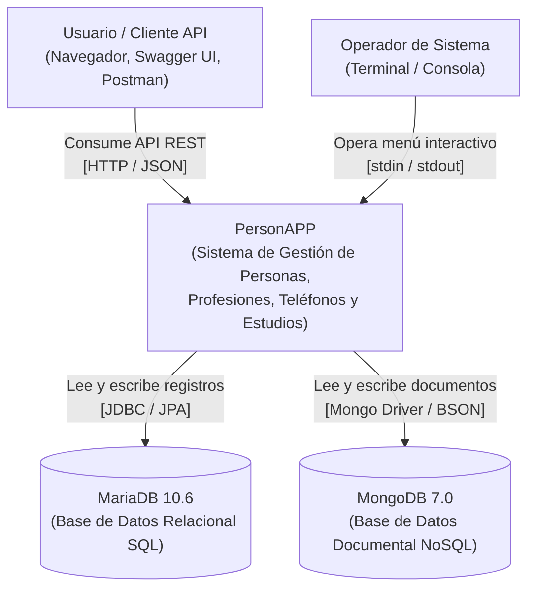
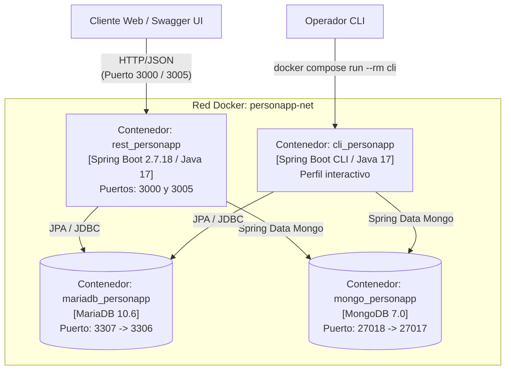
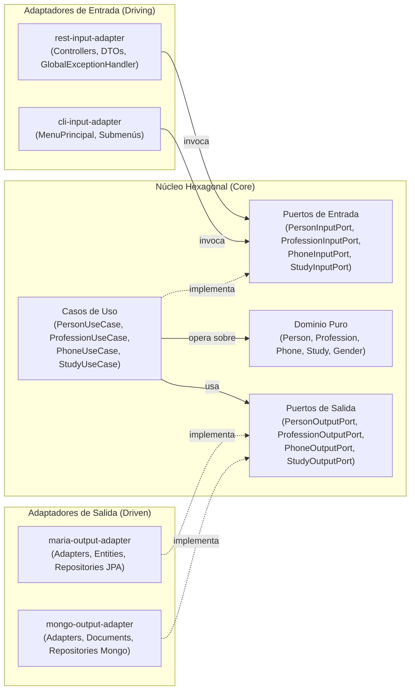

# Diagramas de Arquitectura — Modelo C4 (PersonAPP)

Este documento presenta la arquitectura de **PersonAPP** siguiendo los tres primeros niveles del **Modelo C4** (*Context, Containers, Components*).

---

## Nivel 1: Diagrama de Contexto (System Context)

Muestra a los usuarios que interactúan con el sistema PersonAPP y las bases de datos que lo soportan.

---

## Nivel 2: Diagrama de Contenedores (Containers)

Muestra los contenedores Docker ejecutables dentro de la red privada `personapp-net` definida en `docker-compose.yml`.

---

## Nivel 3: Diagrama de Componentes (Components — Arquitectura Hexagonal)

Muestra cómo se organizan los módulos Maven dentro de la aplicación y cómo se cumple el Principio de Inversión de Dependencias (DIP).

