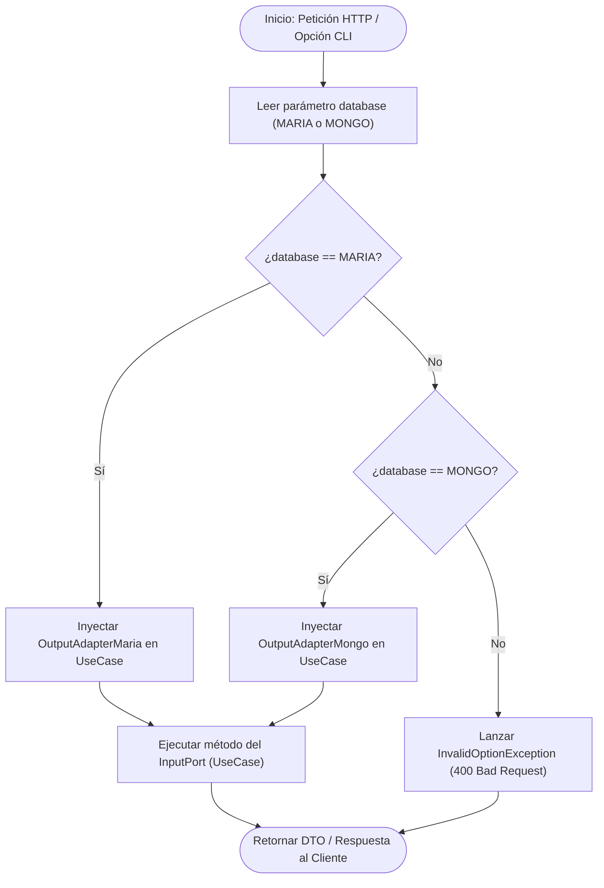
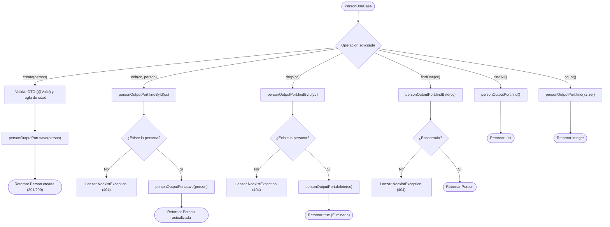
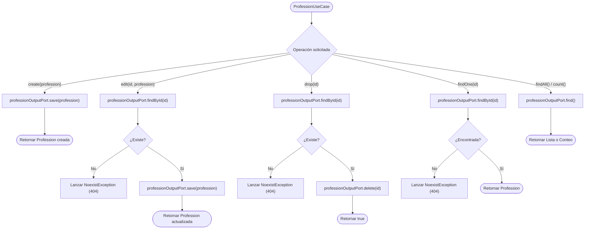
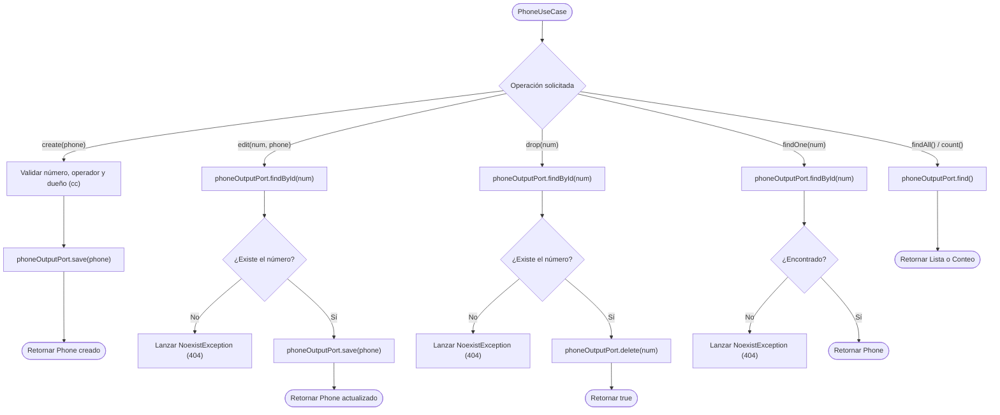
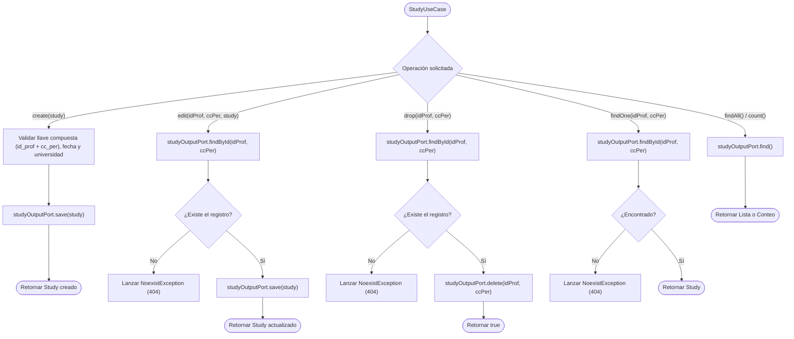

# Diagramas de Flujo por Caso de Uso — PersonAPP

Este documento presenta los diagramas de flujo detallados para el enrutamiento hexagonal dinámico y cada uno de los cuatro Casos de Uso del núcleo de la aplicación (`PersonUseCase`, `ProfessionUseCase`, `PhoneUseCase` y `StudyUseCase`).

---

## 1. Flujo General de Selección Dinámica de Base de Datos (Adaptador de Entrada)

Aplica a **todos** los casos de uso antes de invocar cualquier operación del núcleo:

---

## 2. Caso de Uso: Persona (`PersonUseCase`)

---

## 3. Caso de Uso: Profesión (`ProfessionUseCase`)

---

## 4. Caso de Uso: Teléfono (`PhoneUseCase`)

---

## 5. Caso de Uso: Estudios (`StudyUseCase`)

